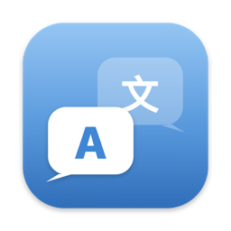

<p align="center">
  
</p>

<h1 align="center">xTrans</h1>

<p align="center">
  Ứng dụng dịch song ngữ bằng AI cho macOS — giao diện dạng chat, gọi thẳng OpenAI API.<br>
  Dán tiếng Trung ra tiếng Việt, dán tiếng Việt ra tiếng Trung — trong cùng một khung hội thoại.
</p>

<p align="center">
  <a href="../../releases/latest"><b>⬇︎ Tải bản mới nhất (.dmg)</b></a>
</p>

---

## Tính năng

- **Hội thoại theo cặp ngôn ngữ** — mỗi cặp (English ⇄ Vietnamese, Chinese ⇄ Vietnamese, …) là một khung chat riêng; thêm / sửa / xoá tuỳ ý, hỗ trợ 14 ngôn ngữ.
- **Dịch hai chiều tự động** — gửi ngôn ngữ 1 ra ngôn ngữ 2 và ngược lại, không cần chọn hướng.
- **Hiểu ngữ cảnh cuộc trao đổi** — các lượt gần nhất được gửi kèm để AI giữ nhất quán xưng hô, tên hàng, mã sản phẩm, giá… Thêm *ghi chú bối cảnh* (vd: "đang đàm phán với nhà cung cấp ở Thâm Quyến"). Bấm ↺ để bắt đầu cuộc trao đổi mới.
- **Gọi thẳng OpenAI** — nhiều tài khoản / API key, chọn model, nhiệt độ, system prompt riêng cho từng hội thoại.
- **Thao tác nhanh** — ⌘V khi ô soạn trống là dán & dịch ngay; nút *Dán & dịch*; bấm vào bản dịch là sao chép.
- **Khung dịch nhanh trên menu bar** — icon luôn ở góc phải; bấm để mở khung chat gọn ở góc màn hình, vẫn nổi khi bạn chuyển sang app khác để copy qua lại.
- **Đóng cửa sổ không thoát app** — xTrans ẩn vào menu bar, mở lại bất cứ lúc nào.
- Giao diện co giãn theo cửa sổ, chế độ sáng / tối, 3 kiểu hình nền.

## Yêu cầu

- macOS **15.7** trở lên (Apple Silicon và Intel)
- Một API key OpenAI — tạo tại [platform.openai.com/api-keys](https://platform.openai.com/api-keys)

## Cài đặt

1. Tải `xTrans-<phiên bản>.dmg` ở mục [Releases](../../releases/latest).
2. Mở file DMG, kéo **xTrans** vào thư mục **Applications**.
3. **Lần mở đầu tiên:** bản phát hành hiện chưa được Apple notarize, nên macOS sẽ báo *"không thể kiểm tra nhà phát triển"*. Cách mở:
   - Chuột phải vào xTrans trong Applications → **Open** → **Open**, hoặc
   - Mở một lần cho macOS chặn, rồi vào **System Settings → Privacy & Security** → kéo xuống, bấm **Open Anyway**.

   Chỉ cần làm một lần.

## Bắt đầu sử dụng

1. Mở **Cài đặt** (⌘,) → tab **Tài khoản OpenAI** → bấm **+**, dán API key, bấm **Kiểm tra kết nối**.
2. Chọn một cặp ngôn ngữ bên trái (hoặc bấm **+** để thêm cặp mới).
3. Dán nội dung cần dịch → **Enter**.
4. Bấm vào avatar / tên hội thoại trên đầu khung chat để chỉnh **Cài đặt hội thoại**: cặp ngôn ngữ, model, số lượt nhớ, ghi chú bối cảnh, system prompt.

### Phím tắt

| Thao tác | Phím |
|---|---|
| Dịch | `Enter` |
| Xuống dòng | `Shift` + `Enter` |
| Dán & dịch ngay (khi ô soạn trống) | `⌘V` / `Ctrl` + `V` |
| Đóng khung dịch nhanh | `Esc` |
| Mở Cài đặt | `⌘,` |

### Icon trên menu bar

- **Bấm trái:** mở / đóng khung dịch nhanh ở góc trên bên phải màn hình.
- **Bấm phải:** Mở cửa sổ lớn · Ẩn cửa sổ · Cài đặt · Thoát.
- Dùng Hidden Bar / Bartender mà không thấy icon? Mở rộng vùng ẩn rồi giữ **⌘** kéo icon xTrans ra vùng luôn hiện — vị trí sẽ được nhớ.

## Bảo mật & dữ liệu

- **API key** được lưu trong **Keychain của macOS** — không ghi ra file, database hay log, không đồng bộ iCloud.
- **Lịch sử, cấu hình** lưu cục bộ bằng SwiftData trong thư mục sandbox của app (`~/Library/Containers/com.nan.xTrans/`).
- Nội dung bạn dịch chỉ được gửi tới **OpenAI** (hoặc Base URL bạn tự cấu hình). App không có máy chủ trung gian, không thu thập dữ liệu.
- App chạy trong **App Sandbox**, chỉ xin quyền kết nối mạng ra ngoài.

> Mẹo: tạo API key riêng cho xTrans và đặt hạn mức chi tiêu trong dashboard OpenAI.

## Build từ mã nguồn

Yêu cầu Xcode 26 trở lên.

```bash
git clone https://github.com/vienkmt/xTrans.git
cd xTrans
open xTrans.xcodeproj
```

Trong Xcode: target **xTrans** → **Signing & Capabilities** → chọn **Team** của bạn (Apple ID miễn phí cũng được) → **⌘R**.

### Đóng gói DMG

```bash
scripts/build-dmg.sh                 # → dist/xTrans-<phiên bản>.dmg
scripts/build-dmg.sh --no-layout     # bỏ bước Finder sắp xếp cửa sổ (dùng cho CI)
scripts/build-dmg.sh --notarize <keychain-profile>   # thêm notarize (cần chứng chỉ Developer ID)
```

Phiên bản lấy từ **Version** của target trong Xcode. Hướng dẫn thiết lập notarize nằm ở cuối file [`scripts/build-dmg.sh`](scripts/build-dmg.sh).

### Cấu trúc mã nguồn

```
xTrans/
├── xTransApp.swift            # Điểm khởi động, các scene (cửa sổ chính, Cài đặt)
├── MenuBarController.swift    # Icon menu bar, khung dịch nhanh, Dock ↔ menu bar
├── Models/                    # Conversation, Message, AIConfig, ngôn ngữ & nhận diện ngôn ngữ
├── Services/                  # OpenAITranslationService, KeychainStore
├── Store/                     # ChatStore, SettingsStore, Persistence (SwiftData)
├── Theme/                     # Bảng màu, hình nền khung chat
└── Views/                     # Sidebar, Chat, Settings, khung dịch nhanh
scripts/
├── build-dmg.sh               # Build Release + đóng gói DMG
└── dmg/                       # Ảnh nền DMG và script vẽ lại
```

## Bản quyền

© 2026 Lac Van Vien. Mã nguồn được công khai để tham khảo; chưa kèm giấy phép sử dụng lại.
